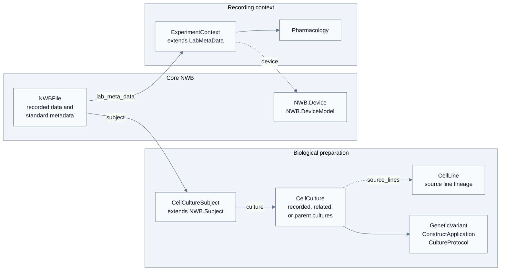

# ndx-cell-culture

[](https://github.com/braingeneers/ndx-cell-culture/actions/workflows/test.yml)
[](https://ndx-cell-culture.readthedocs.io/)

`ndx-cell-culture` is a Neurodata Without Borders (NWB) extension for describing cultured neural preparations in NWB files. It is intended for labs working with organoids, assembloids, directoids/connectoids, slices, explants, spheroids, dissociated cultures, cell lines, defining genetic variants, construct applications, recording context, and pharmacology.

Full user documentation is available at <https://ndx-cell-culture.readthedocs.io/>.

## What It Models

The extension keeps core NWB responsible for devices, acquisition, stimulus, imaging, processing, and other modality-specific data. Cultured-preparation identity and provenance are attached through the subject; recording context and pharmacology live in lab metadata:

```text
NWBFile
+-- subject : CellCultureSubject <extends NWB.Subject>
|   +-- inherited NWB.Subject fields
|   +-- culture -> CellCulture [recorded/described preparation]
|   +-- CellLine [0..N]
|   |   +-- parent_cell_line -> CellLine [0..1]
|   |   +-- GeneticVariant [0..N]
|   |   +-- ConstructApplication [0..N]
|   +-- CellCulture [0..N] [recorded, related, or parent cultures]
|   |   +-- source_lines -> CellLine [0..N]
|   |   +-- parent_cultures -> CellCulture [0..N]
|   |   +-- GeneticVariant [0..N]
|   |   +-- ConstructApplication [0..N]
|   |   +-- CultureProtocol [0..1]
+-- general/devices : NWB.Device [0..N]
+-- general/devices/models : NWB.DeviceModel [0..N] [hardware model metadata]
+-- lab metadata : ExperimentContext <extends LabMetaData>
    +-- device -> NWB.Device [0..1]
    +-- Pharmacology [0..N]
```

The core mental model is to keep biological preparation metadata, core NWB data
and hardware, and recording context distinct but linked:



Use this mental model:

- Put biological identity and provenance in `CellCultureSubject`.
- Put recorded data and hardware in core NWB.
- Put recording conditions and pharmacology in `ExperimentContext`.
- Dotted arrows show stored references: `CellCulture.source_lines` and `ExperimentContext.device`. Subject, recorded culture, and session ID are resolved from the enclosing NWB file by the Python API.
- The diagram uses short labels for readability; the ASCII hierarchy above gives the exact NWB and extension object names.

Use this extension when the biological preparation is a cultured neural system rather than an animal subject, and when the metadata needed to interpret the recording cannot be represented clearly with core `NWB.Subject` alone.

`CellCultureSubject` automatically includes the source lines, parent cultures,
and related applications referenced by its biological objects during construction.
Every `GeneticVariant` requires an explicit, non-empty `origin`; use `unknown`
when its origin is not known.

For DANDI deposition, populate the inherited `subject_id`, `species`, `sex`,
and either `age` or `date_of_birth` fields. Use `U` for unknown sex. Core subject
age describes the donor/source at collection; culture age stays in
`CellCulture.age` or `ExperimentContext.age_at_recording`. These fields retain
core NWB optionality, so schema validation alone does not establish DANDI
readiness. Run NWB Inspector with `--config dandi` before deposition.

## Installation

Install the stable release from PyPI:

```bash
python -m pip install ndx-cell-culture
```

For local development:

```bash
git clone git@github.com:braingeneers/ndx-cell-culture.git
cd ndx-cell-culture
python -m pip install -e ".[dev]"
```

## Documentation

Start with the hosted documentation:

- [Installation and quickstart](https://ndx-cell-culture.readthedocs.io/en/latest/usage.html)
- [Which objects do I need?](https://ndx-cell-culture.readthedocs.io/en/latest/usage.html#which-objects-do-i-need)
- [Modeling guide](https://ndx-cell-culture.readthedocs.io/en/latest/modeling_guide.html)
- [Field reference](https://ndx-cell-culture.readthedocs.io/en/latest/field_reference.html)
- [Examples and recipes](https://ndx-cell-culture.readthedocs.io/en/latest/examples.html)
- [Validation and DANDI notes](https://ndx-cell-culture.readthedocs.io/en/latest/validation_dandi.html)
- [Generated schema reference](https://ndx-cell-culture.readthedocs.io/en/latest/format.html)

## Examples

Run the basic synthetic example:

```bash
python examples/create_basic_organoid_nwb.py
```

Run all synthetic scenario examples:

```bash
python examples/create_synthetic_scenarios.py
```

Generated `.nwb` files are written under `examples/` and ignored by git. The scenarios cover organoid recordings, slices, edited cell lines, pharmacology, directoid-style preparations, and two-line assembloids using synthetic identifiers. Donor ages are synthetic fixture values, separate from culture timing; do not copy them as defaults for real data.

## Development

Regenerate the YAML schema:

```bash
python scripts/create_extension_spec.py
```

Run the local release checks:

```bash
bash scripts/check_release.sh
```

Build the HTML documentation:

```bash
python -m pip install -e ".[docs]"
make -C docs/source html
```

The generated site is written to `docs/_build/html`. Continuous integration runs the same release-check script across supported Python versions, including schema regeneration, PyNWB round-trip tests, example writers, NWB Inspector with its DANDI profile and no subject-age exclusion, docs build, clean wheel installation, and wheel/source distribution checks.

## Status

Version 1.0.0 is the first stable release. The core model is encoded in the schema and documentation, and automated tests cover the public examples and relationship model. See the [release notes](https://ndx-cell-culture.readthedocs.io/en/latest/release_notes.html) for compatibility guidance when working with files created using earlier release candidates.
